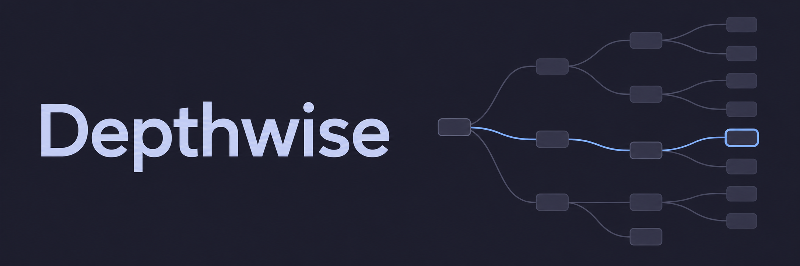

<p align="center">
  
</p>

# Depthwise

Explore Markdown questions, answers, and notes as a branching tree.

Open a folder, follow a question, and read its Markdown in place. Use it for interview preparation, learning a topic, or exploring ideas.

- Follow animated branches with the active path highlighted.
- Edit notes and add follow-up questions.
- Resume where you left off with optional browser storage.
- Export your files as a ZIP, or save to a folder in supported browsers.

## Use it

Drop a Markdown folder onto the page or open a built-in example. Click a question to expand it. Drag the canvas to pan and use the zoom controls to move around.

Arrow keys navigate the tree. Enter or Space toggles a question; Home returns to the root.

## Create a learning folder

Install the authoring skill in your AI agent:

```sh
npx skills@1.7.4 add dis70rt/depthwise --skill depthwise-question-tree
```

Then ask:

> Create a Depthwise question tree about database indexing. Start with the basics, add deeper follow-ups, and include short answers.

The skill follows your prompt. Answers are optional. You can also use [SKILL.md](skills/depthwise-question-tree/SKILL.md) directly without the installer.

The installer is a separate networked CLI. Set `DISABLE_TELEMETRY=1` to opt out of its telemetry.

## Markdown format

Start with `index.md`. Each file has a question as its H1, followed by any Markdown content. Link child questions under `## Follow-up questions`:

```markdown
# How do database indexes work?

An index helps a database find rows without scanning the whole table.

## Follow-up questions

- [When does an index help?](when-to-index.md)
- [What does an index cost?](index-costs.md)
```

Paths are relative to the current file. The follow-up section becomes branches in the viewer. See the [example folder](examples/database-preparation).

Supports UTF-8 Markdown: up to 1,000 files, 1 MiB per file, and 20 MiB per folder.

## Run locally

Use Node.js 22.23.4 (see `.nvmrc`).

```sh
npm ci
npm run dev
```

```sh
npm run check        # Tests, type checking, and production build
npm run format:check
npm run preview     # Serve the production build
```

Built with React, TypeScript, and Vite. See [contributing](CONTRIBUTING.md), [verification](docs/verification.md), and [deployment](docs/release-runbook.md).

## Your files

Markdown stays in your browser. Choose whether to remember your workspace or keep it in the current tab. There are no accounts or document uploads to a server.

Browser storage is not app-encrypted and can be cleared or evicted. Export work you want to keep. Use **Help → Forget saved session** to clear saved app data. Folder overwrites create recovery copies in `.depthwise-backups/`; remove those separately when no longer needed. Use one editing tab per workspace to avoid conflicting saves.

## License and contact

[Apache-2.0](LICENSE) for the app and skill. Third-party licenses are included in the build.

Maintained by Ethernode. Contact: **das.saikat.in@gmail.com**. Report vulnerabilities privately using the [security policy](SECURITY.md).
